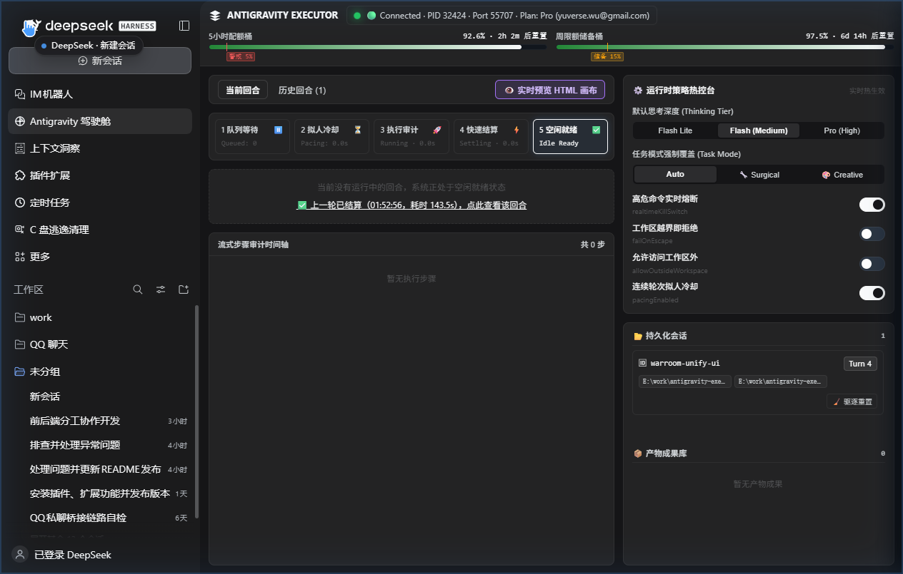
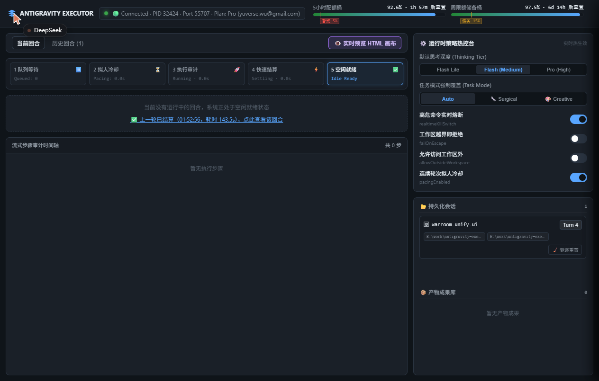

# antigravity-executor

**English** · [简体中文](#简体中文)

Delegate coding tasks from **DeepSeek Harness (dsh)** to the **Google Antigravity**
desktop agent, using the Antigravity account you are already signed in to.

A dsh bundle plugin. It registers three tools on `ctx.tools` and runs entirely
in-process — no MCP server, no sidecar, no external dependencies, no API key.
Every delegation can be watched live in the **War Room dashboard**, either from
a sidebar panel inside dsh or at `http://127.0.0.1:18420` in a browser.

> [!WARNING]
> **This plugin may violate Google's Antigravity terms of service.**
>
> It drives the Antigravity Language Server through its local `agentapi`
> surface, reusing the OAuth session of your signed-in desktop app. Google's
> [Antigravity Terms of Service](https://antigravity.google/terms) state:
>
> > You must not abuse, harm, interfere with, or disrupt the Service. This
> > includes, but is not limited to, using the Service in connection with
> > products not provided by us. **Using third party software, tools, or
> > services to access the Service (e.g. using OpenClaw with Antigravity OAuth)
> > is a breach of this Agreement. Such actions may be grounds for suspension
> > or termination of your Antigravity and/or Gemini CLI accounts.**
>
> You are solely responsible for the consequences of using this plugin,
> including any suspension or termination of your Google accounts. If you want
> a sanctioned path, use the [Antigravity SDK](https://github.com/google-antigravity/antigravity-sdk-python)
> with a Gemini API key or Vertex AI instead.

## Tools

| Tool | Purpose |
| --- | --- |
| `delegate_coding_task` | Hand a coding task to Antigravity; returns its report, an audited tool-call trace, a workspace audit, and any brain artifacts |
| `check_environment` | Diagnose the bridge: desktop app, port, model tiers, effective default tier, workspace policy, **live account quota with reset countdown**, git worktree pre-check, readiness (no model call) |
| `list_conversations` | List threads this plugin started (persisted, so it survives a restart) |

### `delegate_coding_task`

| Parameter | Required | Meaning |
| --- | --- | --- |
| `task_spec` | yes | Target files, required logic, edge cases, interface contracts, acceptance criteria |
| `workspace_dir` | no | Absolute path the executor may touch. **Omit to use the current dsh session's working directory** (recommended). A path outside that directory is refused unless the config sets `allowOutsideWorkspace: true`. |
| `task_mode` | no | `surgical` \| `creative`. **Omit in normal use** — the mode is auto-detected from `task_spec` when the config leaves `taskMode` at `auto`: `creative` for 3D/WebGL/Canvas/shader/game/landing-page/UI work, `surgical` for everything else. Passing it only overrides that detection. |
| `thinking_level` | no | Per-call override: `minimal` / `low` → `flash_lite`, `medium` → `flash`, `high` / `extra_high` → `pro`. Omit to use the configured default. Ignored entirely when `allowOverride: false`. A low-quota account may be auto-downgraded from `pro` to `flash`. |
| `session_id` | no | Stable label for a feature thread; reuse it to continue the same conversation |
| `max_seconds` | no | Wall-clock budget (default from config, 900) |

Every result also carries the git snapshot: `git status --porcelain` and
`git diff --stat` run locally at settlement and are inlined, along with a
`[Notice: Git working tree shows no modified or untracked files.]` line when the
executor claims edits it did not make. Delegations are serialized through an
in-process FIFO queue, so two calls in one reply cannot touch the workspace at
the same time.

### Adaptive task mode

Two personas, one prompt. The hard constraints — absolute paths, workspace
containment, no dev servers — are shared. What differs is the scope rule and an
appended block.

`creative` sends this to the executor:

```
[CREATIVE & VISUAL DENSITY MODE]
- Do NOT build a minimal MVP or use bare single-primitive placeholders (e.g. plain colored boxes as furniture, shelves, or buildings).
- Maximize visual richness and code completeness: build composite multi-part geometries, use InstancedMesh for repeating props/products, generate procedural CanvasTextures for signage/labels/tiles, and configure layered lighting (ambient + directional/spot lights with shadows, emissive materials, and post-processing where applicable).
- Prioritize visual polish, material realism, and interactive details over code brevity.
```

Detection is a keyword match on `task_spec` (`three.js`, `webgl`, `canvas`,
`3d`, `shader`, `pbr`, `orbitcontrols`, `landing page`, `ui design`, `game`,
`animation`, plus `三维` / `3D场景` / `便利店` / `着色器` / `粒子` / `动画` /
`小游戏` / `界面设计` / `视觉效果`). "帮我修个 Bug" → `surgical`, one pass, fast
return. "帮我做个 HTML 3D 便利店场景" → `creative`, density block, and the gate
below on **turn 1 only**:

```
[Supervisor Creative Gate — Pass 1 Completed]
This is Pass 1 of a creative/visual task. Before accepting, inspect the code for visual density:
1. Are objects built from composite geometries and procedural textures (CanvasTexture / PBR materials), or just bare placeholder primitives?
2. Are interior props, lighting atmosphere, and interactive controls fully fleshed out?
If the scene is skeletal or under-detailed, DO NOT finish — immediately call `delegate_coding_task` again with the SAME `session_id` and `task_mode: "creative"` to execute Pass 2 (detail & prop expansion).
```

The gate is emitted once per conversation on purpose: re-emitting it on turn 2
would nag the planner into unlimited expansion rounds, and every extra round
re-sends a longer history against a shared quota pool.

## The War Room dashboard

One report at the end is a thin view of a delegation that ran for minutes: a
9-minute turn and an 8-second one look identical from the dsh conversation, and
a turn that goes sideways at minute 4 leaves nothing to look at. The War Room is
a live console for the turns in flight and the ones that just settled — a
five-stage lifecycle stepper, a streaming audit timeline, both quota windows,
and the controls that change how the next turn runs.

There is **one dashboard, reached two ways**:

- **Inside dsh** — a **sidebar panel icon** that opens the dashboard in the
  centre column, next to your conversation.
- **In any browser** — `http://127.0.0.1:18420`, which works with the dsh window
  closed. The address is also reported by `check_environment`.

Both surfaces are the *same* page: the panel embeds the page the loopback
listener serves, through the same-origin proxy, so there is one renderer, one
set of regions and no visual drift between them. That page consumes the host's
`--dsw-alias-*` theme tokens, so the panel matches the standalone page and
follows light/dark switching.

**The dashboard inside dsh** — sidebar icon selected, centre panel:



*The same dashboard as a panel in the dsh centre column.*

**The same dashboard over loopback** — `http://127.0.0.1:18420`:



*The identical page in a normal browser tab, with the dsh window closed.*

### What it shows

| Region | What it shows |
| --- | --- |
| **Telemetry bar** | Bridge liveness (PID/port/plan/email) and two quota gauges — the 5h window with a red warning tick at `proMinFraction`, and the weekly window with an amber reserve tick at `weeklyProMinFraction` that steps down to the 5h floor inside the last `weeklyReserveHours` (`🔓 最后24h储备已释放`). A pulsing banner appears whenever low-quota protection downgrades `pro` → `flash`. |
| **Lifecycle stepper** | The five phases — queued → pacing → running → settling → idle — with live second counters. The **skip-cooldown** button appears only while pacing, and the red **abort** button only while running. |
| **Step timeline** | Every tool call as it happens: index, tool, summary, duration and an audit verdict pill — `🟢 Clean`, `🟡 Hanging (48s / 60s)`, `🟠 Escape`, or a fully red `🔴 Blocked Destructive` row annotated `⚡ 已触发 80ms 硬件熔断`. |
| **Virtual CWD tracker** | The auditor's live working directory; it turns orange-red the moment a `cd` leaves the workspace. |
| **History replayer** | The last `recentTurnsLimit` (10) settled turns, kept in memory specifically so opening the page *after* a fast turn still shows the steps, report head and `git diff --stat`. |
| **Policy hot controls** | Thinking tier, task-mode override, and four switches (`realtimeKillSwitch`, `failOnEscape`, `allowOutsideWorkspace`, `pacingEnabled`) that take effect on the next turn without a restart. |
| **Sessions / artifacts / preview** | Per-session turn counts with a `⚠️ 长会话高消耗` badge, one-click eviction, `walkthrough.md` / `implementation_plan.md` / `task.md` in a Markdown drawer, and a drag-resizable HTML/3D preview pane that auto-refreshes on `turn:settled` — so you can watch a Three.js scene fill in pass by pass. |

### How it is built

- **`lib/telemetry.mjs`** — an in-process bus holding one snapshot (bridge, quota,
  lifecycle, active turn + steps, a ring buffer of settled turns, sessions,
  artifacts, runtime config). The executor publishes to it; nothing in the
  executor knows HTTP. With **no browser connected the snapshot still updates but
  nothing is serialized**, which is what keeps fast settlement intact.
- **`lib/ui-server.mjs`** — zero-dependency `node:http` bound to `127.0.0.1`
  only. REST for snapshot/control/artifacts, `text/event-stream` for live pushes
  with a 15s heartbeat, and a **path-traversal guard** on the preview route that
  compares against `workspace + sep` (so `C:\work-evil` is correctly *outside*
  `C:\work`). Mutating routes additionally reject a request whose `Origin` /
  `Host` is not loopback.
- **`ui/index.html`** — the single dashboard implementation: the page the
  listener serves at `/`.
- **`lib/proxy.mjs`** — a same-origin prefix (`/antigravity-executor`) inside
  dsh's own web server. The GUI and the dashboard are different origins, so the
  panel could not fetch the listener directly; the proxy streams straight through
  instead, and the standalone surface keeps refusing foreign `Origin` headers
  unchanged. The in-panel view is the listener's own page, reached through this
  prefix.
- **`client.js`** — the sidebar entry and the panel shell. It contributes one
  icon + label to the sidebar's global panel list (id `antigravity-warroom`,
  label 「Antigravity 驾驶舱」); clicking it puts the dashboard in the centre
  column. The panel itself is the page above, embedded — it never re-implements
  the dashboard.

### HMR: the port comes back

A dsh reload re-runs `apply()` while the old listener still holds 18420.
`server.close()` alone does **not** free it — it waits for live connections, and
an open SSE stream never ends. Teardown is therefore: end every SSE response →
`closeAllConnections()` → `close()`. If the port is genuinely held by something
else, the server steps forward to the next free one and reports the real address
in `check_environment` rather than failing.

### Ports and exposure

The listener binds a loopback literal and nothing else — a non-loopback `host`
is a hard validation failure, not a silent downgrade, because anyone on the
network could otherwise abort turns and widen the workspace policy. Setting
`enabled: false` binds no socket at all.

```yaml
ui:
  enabled: true          # false binds no socket at all
  host: 127.0.0.1        # loopback only; anything else is a hard validation failure
  port: 18420            # steps forward when taken
  recentTurnsLimit: 10   # ring-buffer depth for the history replayer
```

## Configuration: thinking level, workspace policy, settlement and safety

Every tunable lives in the bundle patch, so it survives upgrades and applies
immediately on profiles with HMR enabled. Edit the `config` block of
`id: antigravity-executor` in your profile's `cordis.patch.yml` (or the copy
shipped in this package's `cordis.patch.yml`):

```yaml
- insert:
    - id: antigravity-executor
      name: 'antigravity-executor'
      config:
        thinkingLevel: medium        # minimal | low | medium | high | extra_high
        allowOverride: true          # let a call pass thinking_level
        followSessionWorkspace: true # workspace_dir optional, follows the session cwd
        allowOutsideWorkspace: false # refuse a workspace outside the session cwd
        audit: true                  # classify every tool call against the workspace
        failOnEscape: false          # true = reject the result when the audit finds an escape
        maxSeconds: 900

        # Adaptive task-mode persona (auto = decide per call from task_spec)
        taskMode: auto               # auto | surgical | creative

        # Turn settlement (REQ-01)
        pollIntervalSeconds: 2       # scan cadence while the turn runs
        fastSettleSeconds: 2         # confirmation window after the server reports IDLE
        quietWindowSeconds: 45       # fallback only, when the long poll is unavailable

        # Anti-truncation (REQ-02)
        useFullTranscript: true      # prefer transcript_full.jsonl

        # Quota guard (REQ-03)
        quotaFallback:
          enabled: true
          proMinFraction: 0.05       # downgrade pro -> flash below 5% remaining (5h window)
          weeklyProMinFraction: 0.15 # higher reserve for the weekly window
          weeklyGuard: true
          weeklyReserveHours: 24     # skip the weekly guard once the reset is this close
          cacheTtlSeconds: 180       # reuse a quota read this long (0 = off)

        # Safety, persistence, artifacts (REQ-04/06/07)
        realtimeKillSwitch: true     # destructive commands always cut, regardless of failOnEscape
        persistSessions: true        # dead mappings are evicted automatically
        includeBrainArtifacts: true
        maxArtifactInlineChars: 4000 # longer .md files inline a head + their absolute path
        maxArtifactHeadChars: 2000
        longSessionTurns: 8          # suggest a fresh session_id past this many turns
        hangingCommandWarnSeconds: 45    # warn about dev servers / watch processes after this long
        hangingCommandTimeoutSeconds: 60 # then cut the turn (0 = warn only)
        includeGitSummary: true      # inline git status / diff --stat at settlement

        # Human-like pacing — delays only the start of the NEXT turn
        pacing:
          enabled: true
          minGapSeconds: 15
          jitterMinSeconds: 6
          jitterMaxSeconds: 15
```

Every key is optional and defaults are restated above, so an existing profile
keeps loading unchanged.

`thinkingLevel` is the selector: set it once and every delegation uses that
tier. It defaults to `medium` (`flash`). `flash_lite` produces noticeably
sloppier code — for example stray commas in signatures — so raise it to `high`
when correctness matters more than latency, and use `low` only for trivial
edits.

`taskMode` defaults to `auto`, which picks the persona from the task text for
every call; pin it to `surgical` or `creative` to stop the detection, or change
it per call with the `task_mode` argument. `check_environment` reports which of
the three is in force.

### Turn settlement

A turn ends on the Language Server's own RPC state, not on a fixed quiet window,
so a completed delegation returns within a few seconds. `WaitForConversationFullyIdle`
is a real long poll: it blocks while the agent is busy and returns in ~34 ms once
the cascade is idle. Settlement then confirms `CASCADE_RUN_STATUS_IDLE` plus the
trajectory's `terminationReason`, and requires a tool-call-free planner message
plus a short `fastSettleSeconds` window so the brief gap between two tool rounds
is not mistaken for the end.

Two traps this deliberately handles:

- **"Last step is a PLANNER_RESPONSE" is not a completion test.** A background
  `run_command` emits a planner message first and reports completion later via a
  `SYSTEM_MESSAGE`, so completion is decided by the cascade status.
- **The brain log lags the server.** A finished turn can still show only its
  `USER_INPUT` on disk while the RPC already has the final steps, so the
  settlement read merges the RPC view over the file.

`quietWindowSeconds` remains only as the fallback used when the long poll is
unavailable (method missing, or a non-timeout transport failure).

### Quota-aware fallback

`check_environment` reports the account plan and, per tier and per window
(5-hour / weekly), the remaining fraction and reset countdown:

```
quota        : plan=Pro (you@example.com)
  buckets:
    Gemini Models / gemini-5h (5h): 99%, resets in 4h 23m
    Gemini Models / gemini-weekly (weekly): 98%, resets in 1d 5h
```

With `quotaFallback.enabled`, a `pro` delegation whose remaining fraction is
below `proMinFraction` runs on `flash` instead, and the report says so
(`downgraded: pro -> flash (low quota)`). The weekly window carries its own,
higher reserve: inside the last `weeklyReserveHours` before a reset the 15 %
reserve is released, but the 5 % floor still holds
(`pro -> flash (weekly quota floor)`) — a drained week costs days, a drained 5h
window costs hours. Quota reads are cached for `cacheTtlSeconds` and abandoned
near the guard threshold; `check_environment` always reads live.

When the tier cannot be identified the plugin keeps the requested tier rather
than guessing — a parse failure must not silently downgrade a task.

### Hanging commands and dead sessions

A command that will never exit is cut, not merely noted: when no new step
appears for `hangingCommandTimeoutSeconds` the turn is aborted with
`Aborted after 60s: hanging/interactive command detected (…)`, instead of
burning the whole `maxSeconds` budget. Dev servers and watch processes are
forbidden by the preamble and the bundled skill; `hangingCommandWarnSeconds`
emits the earlier warning.

A persisted `session_id → conversation_id` mapping can outlive its
conversation. The first dead turn evicts it, opens a fresh conversation, and
prepends a **context recovery banner** (last touched files plus the previous
task head) so the executor is not asked to continue from nothing; the result
then carries `session_evicted_and_recreated: true`. Each session also carries a
turn count, and past `longSessionTurns` the result suggests starting a fresh
`session_id`.

### Pacing

`pacing.minGapSeconds` never slows down a turn you are waiting for. The result
still comes back as fast as the RPC reports IDLE. What the pacer does is top up
the gap before the *next* delegation when the previous one ended moments ago,
with a jittered delay so the gaps are not metronome-regular. It is a mitigation
for one specific signature (zero-think-time re-dispatch against a real
signed-in account), not a guarantee of looking organic.

## Workspace: follows the session, audited afterwards

`delegate_coding_task` defaults its workspace to the **current dsh session's
working directory**, read from the session header. Omit `workspace_dir` and the
executor works where the conversation works. Passing a path outside that
directory is refused unless `allowOutsideWorkspace: true`, so a typo in a task
spec cannot aim the executor at `C:\Windows`.

**This is a soft sandbox, not kernel-enforced containment.** Antigravity's
`agentapi` offers no workspace parameter: a conversation created through it
carries `workspaces: []` and `enforcedWorkspaceValidation: false` in its own
metadata, so the executor's filesystem reach is decided by the model's
cooperation. What this plugin adds is an **auditor**: it reads the transcript,
classifies each `read_file` / `run_command` against the workspace, and appends a
verdict to the report:

```
--- workspace audit (soft sandbox) ---
workspace    : C:\projects\demo
activity     : 1 command(s), 0 read(s), 0 write-shaped command(s)
verdict      : CLEAN - no out-of-workspace access detected in the transcript
```

It flags three families of finding: writes outside the workspace, a
`Set-Location` that leaves it, and destructive commands (`format`, `diskpart`,
recursive deletes, wildcard deletes, `reg delete`, remote-script piping, and the
PowerShell alias spellings of all of the above). Writes to `**/.git/hooks/**`
and `**/.git/config` count as destructive rather than as in-workspace activity:
a hook — or a `core.hooksPath` / `core.fsmonitor` value — written there executes
as you the next time git runs. Reads of Antigravity's own guide files are listed
separately as benign context rather than violations.

The auditor is stateful: it is fed one step at a time while the turn runs, so
`push()` can return `blocked` and the turn can be cancelled mid-flight. It also
tracks a **virtual working directory** across the turn, so `cd ../..` in one
step makes `../../secret.txt` in the next resolve to the path it really touches,
and it expands PowerShell/Bash aliases (`sl`, `ri`, `pushd`) and environment
variables (`$env:USERPROFILE`, `$env:TEMP`, `~`) before classifying.

### The kill switch

`realtimeKillSwitch` and `failOnEscape` are not the same kind of switch.
`failOnEscape` answers "should an out-of-workspace *escape* fail this turn?" —
one legitimate answer is `false`, because the executor sometimes reads a
reference file outside the project. The breaker must not be gated on it, or a
shipped `failOnEscape: false` would leave it disarmed, and a `reg delete` or a
`Remove-Item -Recurse -Force` would be *reported* afterwards rather than
*stopped*. The verdict is therefore split:

```js
const verdict = auditor.push(step)
verdict.blockedDestructive  // reg delete, diskpart, rd /s /q, ri -Recurse, …  -> cut on realtimeKillSwitch alone
verdict.blockedEscape       // cd-outside, write-outside                     -> still needs failOnEscape
```

`classifyFinding(kind)` is the exported rule behind those two flags.

Keep `realtimeKillSwitch: true` (the default) to turn a *destructive command*
finding into an immediate cancellation; add `failOnEscape: true` as well if you
want plain workspace escapes (`cd-outside`, `write-outside`) to interrupt the
turn too. This is a real interrupt, not a post-hoc verdict: measured,
`CancelCascadeInvocation` moves the cascade to `IDLE` / `USER_CANCELED` within
~80 ms.

It is still an auditor, not a sandbox. See the limitations section.

## Bundled skill: `supervisor-workflow`

The package ships a workflow skill that turns the calling model into a
**planner/supervisor** and the executor into the only writer:

- the model may read the codebase with its own tools, but must not edit
  business source itself — every change goes through `delegate_coding_task`
- dispatches must carry absolute paths plus the `Set-Location` /
  PowerShell preamble, or the executor wastes a minute running commands in
  Antigravity's install directory
- the supervisor must **verify independently** after every delegation: read the
  diff, run the tests, and never accept the executor's self-report as a result
- three consecutive failed review rounds is a hard stop that hands the decision
  back to the human

The skill registers itself through `ctx.skills`, so it appears exactly where the
plugin is enabled and disappears when the bundle is toggled off. Its body lives
at `skills/supervisor-workflow/SKILL.md` and ships with the package — the
workflow and the tools it drives cannot drift apart across upgrades.

You do not need to install or configure anything extra; invoke it by name if
your harness supports skill invocation, or simply tell the model to follow it.

## How it works

The plugin talks to Antigravity through three channels:

1. `language_server.exe agentapi` — start a conversation, send a message. `execFile`
   passes argv without a shell, so multi-line prompts and embedded quotes survive
   intact.
2. `~/.gemini/antigravity/brain/<conversation-id>/.system_generated/logs/transcript_full.jsonl`
   — the untruncated turn log, used for the report and the audit.
3. The Language Server's own **ConnectRPC** surface (`POST /exa.language_server_pb.LanguageServerService/<Method>`)
   — `WaitForConversationFullyIdle` for settlement, `GetCascadeTrajectory` /
   `GetAllCascadeTrajectories` for state, `GetUserStatus` /
   `RetrieveUserQuotaSummary` for quota, `GetCascadeTrajectorySteps` as the
   untruncated transcript fallback, and `CancelCascadeInvocation` for the kill
   switch. Every call carries `X-Codeium-Csrf-Token` and `Connect-Protocol-Version: 1`.

Discovery is platform-specific: Windows enumerates `language_server*.exe` via
`Get-CimInstance Win32_Process` and reads ports from `netstat -ano`; macOS/Linux
use `ps -ax -o pid=,command=` and `lsof -nP -iTCP -sTCP:LISTEN` (falling back to
`ss -tlnp`). The CSRF token comes from the process command line. Results are
cached and revalidated with a cheap probe, and a cached identity is dropped
automatically on `ECONNREFUSED` / 401 / 403, so restarting the desktop app does
not require restarting dsh.

A turn settles when the server reports `CASCADE_RUN_STATUS_IDLE` with a terminal
`terminationReason` **and** a tool-call-free planner message exists **and** a
short confirmation window passes with no new step.

Override the Language Server path with `AGY_LANGUAGE_SERVER` if Antigravity is
installed somewhere unusual.

### The dashboard half

The console ships in the same package as two rows of the composed config, and
they must be enabled and disabled together — the client half has nothing to talk
to without the host half. `lib/index.js` is the host row: the tools, the
telemetry bus, and the `node:http` listener on the loopback port. `client.js` is
the client row: it contributes an icon and label to the sidebar's global panel
list and, when clicked, puts the dashboard in the centre column.
`ui/index.html` is the dashboard itself — the single implementation, served at
`/` by `lib/ui-server.mjs` and reached from inside the GUI through the
same-origin `/antigravity-executor` prefix in `lib/proxy.mjs`. The panel embeds
that page rather than re-rendering the state, so the two surfaces cannot drift
apart.

## Install

This is a dsh **bundle plugin**, installed with `dsh plugin … add`. Pick whichever
form matches how dsh is installed on your machine.

### From npm (recommended)

```bash
dsh plugin --profile <profile> add antigravity-executor
```

Replace `<profile>` with your profile name — `web` for a plain `dsh web`
install, or `tauri` for the desktop app. The command forwards `add` to pnpm in
the profile directory and appends the package to `dsh.profile.bundles`.

If `dsh` is not on your `PATH`, call the launcher directly from the dsh
installation directory:

```bash
# Desktop app install
node node_modules/@deepseek-ai/dsh/lib/bin.js plugin --profile tauri add antigravity-executor

# Or via npx
npx -y @deepseek-ai/dsh plugin --profile web add antigravity-executor
```

### From a local checkout

Useful when hacking on the plugin itself — a `link:` dependency points at your
working copy, so edits take effect without reinstalling:

```bash
git clone https://github.com/wuyu1327083461/antigravity-executor.git
dsh plugin --profile <profile> add "link:$(pwd)/antigravity-executor"
```

On Windows PowerShell:

```powershell
git clone https://github.com/wuyu1327083461/antigravity-executor.git
dsh plugin --profile tauri add "link:F:/path/to/antigravity-executor"
```

### Verify and enable

```bash
# The row should appear in the composed config
dsh --profile <profile> --dump-config   # look for `id: antigravity-executor`
```

Then enable it in the dsh Web UI: **Plugins → Installed plugins → Antigravity
Executor**. Toggling it off unregisters the tools; nothing is spawned either
way, so there is no process to kill. The switch writes
`disabled: true|false` for `id: antigravity-executor` into the profile's
`cordis.patch.yml` and takes effect immediately on profiles with HMR enabled.

### Uninstall

```bash
dsh plugin --profile <profile> remove antigravity-executor
```

That drops the dependency and the bundle entry. The plugin keeps no state
outside its own directory (`sessions.json` lives there and is gitignored).

## Requirements

- **Antigravity desktop app running and signed in** (minimised is fine — it
  must not be quit). No API key is involved.
- Node.js ≥ 22.19.0 (whatever dsh itself needs)

## Known limitations

**There is no kernel-enforced filesystem sandbox.** `agentapi` creates
conversations with `workspaces: []` and `enforcedWorkspaceValidation: false`,
so "only touch this directory" is a prompt-level guard plus an auditor, not
containment. The plugin injects a preamble into every dispatched task (absolute
paths, the per-platform working-directory prefix, shell syntax notes) and then
verifies what actually happened, cancelling mid-flight when configured to do so,
but a determined executor is not physically stopped.

`run_command` executes in **PowerShell** on Windows and a POSIX shell elsewhere,
and its default working directory is the Antigravity install directory, not your
project — which is why the `Set-Location` / `cd` prefix in the preamble is
mandatory rather than decorative.

Because of the above, always review the diff and run the verification yourself
after a delegation. The tool returns an audited tool-call trace and a workspace
verdict to make that easy, and the model's self-report should be treated as a
claim, not a result.

**Region restrictions are the backend's, not the plugin's.** Antigravity's
service can answer `FAILED_PRECONDITION (code 400): User location is not
supported for the API use.` The plugin surfaces that text verbatim and fails
within a few seconds instead of burning the whole `maxSeconds` budget, but it
cannot route around it.

**A turn the server reports as finished but the disk log has not yet flushed is
read through RPC.** That is the settlement path; the final report still prefers
the on-disk transcript, which carries the complete historical turn.

**The dashboard needs the host's web server to appear in-app.** The sidebar panel
is the loopback page reached through the host's same-origin proxy, so a profile
without a `webServer` service has no carrier for it — only
`http://127.0.0.1:18420` is available there, and that is the same page. With
`ui.enabled: false` no socket is bound at all and neither surface exists; the
tools keep working either way, because the executor never depends on the
listener (with no browser connected the snapshot is updated but not serialized).

## Development

```bash
npm test                      # node --test lib/*.test.js
node --test lib/turn.test.js  # one module
```

Tests never touch Antigravity: the RPC client, transcript reader and clock are
injectable, so every settlement path (rpc-idle, quiet-window fallback, kill
switch, timeout, executor-error) is exercised deterministically. `CONTRACT.md`
records the module interfaces and the measured RPC facts the implementation
depends on.

## License

MIT. See the warning at the top: the licence covers this code, not your
compliance with anyone else's terms.

---

# 简体中文

[English](#antigravity-executor) · **简体中文**

把编码任务从 **DeepSeek Harness（dsh）** 委派给 **Google Antigravity 桌面端**，
复用你已经登录的 Antigravity 账号额度。

这是一个 dsh bundle 插件。它在 `ctx.tools` 上注册三个工具，全部在进程内运行
——没有 MCP 服务、没有旁路进程、没有外部依赖、不需要 API Key。每次委派都可以在
**War Room 驾驶舱**里实时观看：dsh 内的侧边栏面板，或浏览器里的
`http://127.0.0.1:18420`。

> [!WARNING]
> **本插件可能违反 Google Antigravity 的服务条款。**
>
> 它通过本地 `agentapi` 接口驱动 Antigravity Language Server，复用桌面端已登录
> 的 OAuth 会话。Google 的
> [Antigravity 服务条款](https://antigravity.google/terms) 明确写明：
>
> > 你不得滥用、损害、干扰或破坏本服务，包括但不限于将本服务与并非由我们提供的
> > 产品结合使用。**使用第三方软件、工具或服务访问本服务（例如用 OpenClaw 搭配
> > Antigravity OAuth）即违反本协议，可能导致你的 Antigravity 和/或 Gemini CLI
> > 账号被暂停或终止。**
>
> 使用本插件的一切后果由你自行承担，包括 Google 账号被暂停或终止。若需要合规
> 路径，请改用 [Antigravity SDK](https://github.com/google-antigravity/antigravity-sdk-python)
> 配合 Gemini API Key 或 Vertex AI。

## 工具

| 工具 | 用途 |
| --- | --- |
| `delegate_coding_task` | 把编码任务交给 Antigravity；返回它的报告、经审计的工具调用轨迹、工作区审计结论，以及它产出的 brain 产物 |
| `check_environment` | 诊断桥接状态：桌面端、端口、模型档位、默认档位、工作区策略、**账号实时额度与重置倒计时**、git worktree 预检、可用性（不产生模型调用） |
| `list_conversations` | 列出本插件发起过的会话线程（已落盘，重启后仍可见） |

### `delegate_coding_task`

| 参数 | 必填 | 含义 |
| --- | --- | --- |
| `task_spec` | 是 | 目标文件、所需逻辑、边界条件、接口契约、验收标准 |
| `workspace_dir` | 否 | 执行器可触碰的绝对路径。**省略则使用当前 dsh 会话的工作目录**（推荐）。位于该目录之外的路径会被拒绝，除非配置里设了 `allowOutsideWorkspace: true`。 |
| `task_mode` | 否 | `surgical` \| `creative`。**正常使用请省略**——当配置里 `taskMode` 保持 `auto` 时，插件会按 `task_spec` 自动判定：3D/WebGL/Canvas/着色器/游戏/落地页/UI 类任务取 `creative`，其余取 `surgical`。传入只是覆盖自动判定。 |
| `thinking_level` | 否 | 单次覆盖：`minimal` / `low` → `flash_lite`，`medium` → `flash`，`high` / `extra_high` → `pro`。省略则用配置默认档位；当 `allowOverride: false` 时该参数被完全忽略。额度不足时可能被自动从 `pro` 降级到 `flash`。 |
| `session_id` | 否 | 功能线程的稳定标签；复用同一个值即可在返工轮次里延续同一会话 |
| `max_seconds` | 否 | 本次委派的墙钟预算（默认取配置值 900） |

每份结果里也带 git 快照：结算时在本地跑 `git status --porcelain` 与
`git diff --stat` 并内联进报告；当执行器声称改了文件而工作区干净时，会附上
`[Notice: Git working tree shows no modified or untracked files.]`。委派之间由进程内
先进先出队列串行化，所以同一条回复里的两次调用不会同时动工作区。

### 自适应任务模式

两套人格，同一份 prompt。硬性约束（绝对路径、工作区围栏、禁止常驻进程）共用，
不同的只是范围规则与追加内容。

`creative` 会把这套规范发给执行器：

```
[CREATIVE & VISUAL DENSITY MODE]
- Do NOT build a minimal MVP or use bare single-primitive placeholders (e.g. plain colored boxes as furniture, shelves, or buildings).
- Maximize visual richness and code completeness: build composite multi-part geometries, use InstancedMesh for repeating props/products, generate procedural CanvasTextures for signage/labels/tiles, and configure layered lighting (ambient + directional/spot lights with shadows, emissive materials, and post-processing where applicable).
- Prioritize visual polish, material realism, and interactive details over code brevity.
```

判定是对 `task_spec` 做关键词匹配（`three.js`、`webgl`、`canvas`、`3d`、`shader`、`pbr`、
`orbitcontrols`、`landing page`、`ui design`、`game`、`animation`，以及 `三维`、`3D场景`、
`便利店`、`着色器`、`粒子`、`动画`、`小游戏`、`界面设计`、`视觉效果`）。
「帮我修个 Bug」→ `surgical`，一轮快返；「帮我做个 HTML 3D 便利店场景」→ `creative`，
带上密度规范，并在**仅第 1 轮**追加下面这段门禁：

```
[Supervisor Creative Gate — Pass 1 Completed]
This is Pass 1 of a creative/visual task. Before accepting, inspect the code for visual density:
1. Are objects built from composite geometries and procedural textures (CanvasTexture / PBR materials), or just bare placeholder primitives?
2. Are interior props, lighting atmosphere, and interactive controls fully fleshed out?
If the scene is skeletal or under-detailed, DO NOT finish — immediately call `delegate_coding_task` again with the SAME `session_id` and `task_mode: "creative"` to execute Pass 2 (detail & prop expansion).
```

门禁每个会话只发一次是刻意设计：第 2 轮还发，就等于逼主模型无限续轮，
而每多一轮都要携带更长的历史，烧的是同一个共享配额池。

## War Room 驾驶舱

一次委派本来是个黑盒：唯一的输出就是末尾那份报告，所以一个 9 分钟的回合和一个
8 秒的回合，从 dsh 会话里看完全一样。War Room 是一个实时控制台，既看正在跑的回合，
也看刚刚结算的那些——五阶段状态机、流式审计时间轴、双窗口配额，以及决定下一轮怎么跑的
那些开关。

**只有一个驾驶舱，两种打开方式**：

- **dsh 内**——侧边栏上的一个**面板图标**，点开就在中央栏打开驾驶舱，和你的对话并排。
- **任意浏览器**——`http://127.0.0.1:18420`，dsh 窗口关掉也能用。地址同时会出现在
  `check_environment` 的报告里。

两个入口是**同一个页面**：面板通过同源代理嵌入回环监听器提供的那张页面，所以只有
一套渲染逻辑、一套区域划分，两边不会长得不一样。该页面直接消费宿主的
`--dsw-alias-*` 主题 token，因此面板与独立页面一致，并跟随明暗主题切换。

**dsh 内的驾驶舱**——侧边栏图标选中，中央面板：


*同一个驾驶舱，作为面板开在 dsh 中央栏。*

**同一个驾驶舱，走回环地址**——`http://127.0.0.1:18420`：


*完全相同的页面，在普通浏览器标签页里打开，dsh 窗口已关闭。*

### 能看到什么

| 区域 | 内容 |
| --- | --- |
| **遥测条** | 桥接状态（PID/端口/套餐/邮箱）与两根配额条：5h 桶在 `proMinFraction` 处有红色警戒刻度；周限额桶在 `weeklyProMinFraction` 处有黄色储备刻度，并在最后 `weeklyReserveHours` 内退守到 5h 底线（`🔓 最后24h储备已释放`）。一旦低额度保护把 `pro` 降级为 `flash`，右上角常驻闪烁徽章。 |
| **五阶段状态机** | 队列等待 → 拟人冷却 → 执行审计 → 快速结算 → 空闲就绪，带实时读秒。**跳过冷却**按钮只在 pacing 阶段出现，红色**中断**按钮只在 running 阶段出现。 |
| **步骤时间轴** | 每次工具调用实时入列：序号、工具、摘要、耗时，以及审计判定徽章 —— `🟢 Clean`、`🟡 Hanging (48s / 60s)`、`🟠 Escape`，或整行标红的 `🔴 Blocked Destructive`（附 `⚡ 已触发 80ms 硬件熔断`）。 |
| **虚拟工作目录追踪** | 审计器算出的当前目录；一旦 `cd` 跳出工作区，立刻变橙红。 |
| **历史回合回溯** | 内存中保留最近 `recentTurnsLimit`（10）个已结算回合。这正是为了做到「**快结算之后打开页面仍能看到刚才发生了什么**」——步骤流、报告摘要与 `git diff --stat` 都在。 |
| **策略热控台** | 思考档位、任务模式覆盖（`auto` / `surgical` / `creative`），以及四个开关（`realtimeKillSwitch`、`failOnEscape`、`allowOutsideWorkspace`、`pacingEnabled`），下一轮即生效，无需重启。 |
| **会话 / 产物 / 预览** | 每个会话的轮次计数与 `⚠️ 长会话高消耗` 徽章、一键驱逐、`walkthrough.md` / `implementation_plan.md` / `task.md` 的 Markdown 抽屉，以及可拖拽宽度的 HTML/3D 预览分屏——`turn:settled` 时自动刷新，于是 Three.js 场景可以一轮一轮看着它丰满起来。 |

### 实现要点

- **`lib/telemetry.mjs`**：进程内事件总线，维护一份完整快照（桥接、配额、
  生命周期、当前回合及其步骤、已结算回合环形缓冲、会话、产物、运行时配置）。
  执行器只负责往总线上 emit，完全不知道 HTTP 的存在。**没有任何浏览器连接时，
  快照照常更新但一个字节都不序列化** —— 这正是极速结算不被拖慢的原因。
- **`lib/ui-server.mjs`**：零依赖 `node:http`，只绑 `127.0.0.1`。REST 提供快照/
  控制/产物，`text/event-stream` 做实时推送（15 秒心跳）。预览路由带**路径穿越
  防护**：用 `workspace + sep` 比对，所以 `C:\work-evil` 会被正确判定为
  `C:\work` 之外。写操作另外校验 `Origin` / `Host`，非回环一律拒绝。
- **`ui/index.html`**：驾驶舱的唯一实现，也就是监听器在 `/` 上提供的那张页面。
- **`lib/proxy.mjs`**：在 dsh 自己的 Web 服务上注册同源前缀
  （`/antigravity-executor`）。GUI 与驾驶舱是不同 origin，面板无法直接访问监听器；
  这里用直通代理，独立页面的写操作接口仍然照旧拒绝外部 `Origin`。**面板里看到的
  就是监听器自己的那张页面**，只是经由这个前缀抵达。
- **`client.js`**：向侧边栏的全局面板列表贡献一个图标与标签（id
  `antigravity-warroom`，标签「Antigravity 驾驶舱」），点击把驾驶舱放进中央栏；
  面板内容就是上面那张页面，不再另写一套渲染。

### HMR：端口是真的会被释放

dsh 热重载会在旧监听仍占着 18420 时重新执行 `apply()`。光调 `server.close()`
**不会**释放端口——它要等活跃连接结束，而一条 SSE 流永远不会自己结束。所以
销毁顺序是：先结束所有 SSE 响应 → `closeAllConnections()` → `close()`。如果端口
确实被别的进程占着，服务器会自动顺延到下一个空闲端口，并在 `check_environment`
里报告真实地址，而不是直接失败。

### 监听范围与暴露面

监听器只绑回环地址字面量，别的值一律是硬校验失败而不是静默降级——否则同一网段里
任何人都能中断回合、放宽工作区策略。`enabled: false` 则完全不起任何监听。

```yaml
ui:
  enabled: true          # false 则完全不起监听
  host: 127.0.0.1        # 仅允许回环地址；其它值会被校验直接拒绝
  port: 18420            # 被占用时自动顺延
  recentTurnsLimit: 10   # 历史回合环形缓冲深度
```

## 配置：思考档位、工作区策略、结算与安全

所有可调项都写在 bundle patch 里，因此能跨升级保留，并在开启 HMR 的 profile 上
即时生效。编辑 profile 的 `cordis.patch.yml` 中 `id: antigravity-executor` 的
`config` 块（或本包自带的 `cordis.patch.yml`）：

```yaml
- insert:
    - id: antigravity-executor
      name: 'antigravity-executor'
      config:
        thinkingLevel: medium        # minimal | low | medium | high | extra_high
        allowOverride: true          # 允许单次调用传 thinking_level
        followSessionWorkspace: true # workspace_dir 可省略，跟随会话 cwd
        allowOutsideWorkspace: false # 拒绝会话工作区之外的 workspace
        audit: true                  # 把每次工具调用对照工作区分类
        failOnEscape: false          # true = 审计发现越界即判定结果不可采纳
        maxSeconds: 900

        # 自适应任务模式人格（auto = 每次调用按 task_spec 判定）
        taskMode: auto               # auto | surgical | creative

        # 回合结算 (REQ-01)
        pollIntervalSeconds: 2       # 回合运行期间的扫描节奏
        fastSettleSeconds: 2         # 服务端报 IDLE 后的确认窗口
        quietWindowSeconds: 45       # 仅作兜底，长轮询不可用时才用

        # 反截断 (REQ-02)
        useFullTranscript: true      # 优先 transcript_full.jsonl

        # 额度保护 (REQ-03)
        quotaFallback:
          enabled: true
          proMinFraction: 0.05       # 5h 窗口：pro 剩余低于 5% 时降级 flash
          weeklyProMinFraction: 0.15 # 周限额用更高水位单独保护
          weeklyGuard: true
          weeklyReserveHours: 24     # 距重置不足这么多小时则不启用周保护
          cacheTtlSeconds: 180       # 配额缓存秒数（0 = 关闭）

        # 安全、持久化、产物 (REQ-04/06/07)
        realtimeKillSwitch: true     # 破坏性命令无条件熔断，与 failOnEscape 无关
        persistSessions: true        # 失效映射会自动剔除
        includeBrainArtifacts: true
        maxArtifactInlineChars: 4000 # 更长的 .md 只内联开头 + 绝对路径
        maxArtifactHeadChars: 2000
        longSessionTurns: 8          # 超过这么多轮提示换新 session_id
        hangingCommandWarnSeconds: 45    # dev server / watch 持续这么久后告警
        hangingCommandTimeoutSeconds: 60 # 之后直接掐断本轮（0 = 只告警）
        includeGitSummary: true      # 结算时内联 git status / diff --stat

        # 拟人冷却 —— 只延迟「下一轮」的开始
        pacing:
          enabled: true
          minGapSeconds: 15
          jitterMinSeconds: 6
          jitterMaxSeconds: 15
```

每个键都可选，默认值已在上方重述，因此现有的 profile 可原样加载。

`thinkingLevel` 是选择器：设一次，之后每次委派都用该档位，默认 `medium`
（`flash`）。`flash_lite` 产出的代码明显更潦草（例如函数签名里冒出多余逗号），
所以正确性优先于延迟时把它调到 `high`，而 `low` 只用于琐碎改动。

`taskMode` 默认 `auto`，即每次调用都按任务文本判定人格；改成 `surgical` 或
`creative` 则固定下来，也可以在单次调用里用 `task_mode` 参数覆盖。
`check_environment` 会报告当前生效的是哪一种。

### 回合结算

回合依据 Language Server 自身的 RPC 状态结束，而不是固定静默窗口，所以一个已经
完成的委派会在几秒内返回。`WaitForConversationFullyIdle` 是真正的长轮询：agent 忙时
它阻塞，cascade 一空闲它约 34 毫秒就返回。结算随后确认 `CASCADE_RUN_STATUS_IDLE`
与该轨迹的 `terminationReason`，并要求存在一条不带工具调用的 planner 消息，外加一个
短暂的 `fastSettleSeconds` 确认窗口，避免把两轮工具之间的间隙误判成结束。

这里刻意处理了两个坑：

- **「最后一步是 PLANNER_RESPONSE」不是结束判据。** 后台 `run_command` 会先发一条
  planner 消息，稍后再通过 `SYSTEM_MESSAGE` 回报完成，所以结束与否由 cascade
  状态决定。
- **brain 日志滞后于服务端。** 一个已经结束的回合，磁盘上可能只有 `USER_INPUT`，
  而 RPC 已经有最终步骤，因此结算读取会用 RPC 视图覆盖磁盘视图。

`quietWindowSeconds` 仅作为长轮询不可用时（方法缺失，或非超时的传输失败）的兜底。

### 额度感知降级

`check_environment` 会报告账号套餐，并按档位、按窗口（5 小时 / 每周）给出剩余比例
与重置倒计时：

```
quota        : plan=Pro (you@example.com)
  buckets:
    Gemini Models / gemini-5h (5h): 99%, resets in 4h 23m
    Gemini Models / gemini-weekly (weekly): 98%, resets in 1d 5h
```

开启 `quotaFallback.enabled` 后，若一次 `pro` 委派的剩余比例低于
`proMinFraction`，会自动改用 `flash` 执行，并在报告里注明
（`downgraded: pro -> flash (low quota)`）。周限额桶有自己更高的储备线：在距重置
不足 `weeklyReserveHours` 时会放开 15% 储备，但 **5% 底线仍然守住**
（`pro -> flash (weekly quota floor)`）——周限额用光要等几天，5h 桶只需几小时。
配额读取会缓存 `cacheTtlSeconds`，逼近警戒线时自动放弃缓存；`check_environment`
始终实时读取。

当档位无法识别时，插件保持你请求的档位而不是猜一个 —— 解析失败绝不能变成静默降级。

### 常驻命令与失效会话

永远不会退出的命令会被**掐断**，而不只是记录：当 `hangingCommandTimeoutSeconds`
内没有出现新步骤，本轮会以
`Aborted after 60s: hanging/interactive command detected (…)` 中止，而不是烧完整个
`maxSeconds` 预算。dev server 与 watch 进程被前置说明和内置技能双重禁止；
`hangingCommandWarnSeconds` 负责更早的那次告警。

持久化的 `session_id → conversation_id` 映射可能活得比会话还久。首次 dead turn
会剔除它、开一个新会话，并注入**上下文恢复头**（上一轮触碰的文件 + 任务摘要），
免得让执行器在空白上下文里硬猜；结果里会带
`session_evicted_and_recreated: true`。每个会话还会记录轮次，超过
`longSessionTurns` 后会提示换一个新的 `session_id`。

### 拟人冷却

`pacing.minGapSeconds` 绝不会让你正在等的这一轮变慢——结果依然在 RPC 报 IDLE 的
瞬间返回。冷却做的是：当上一轮刚刚结束就立刻又收到委派时，补足间隔，并叠加随机抖动，
避免间隔过于规整。它是针对**单一特征**（对真实登录账号的「零思考时间」连发）的缓解
手段，不是「伪装成人类」的保证。

## 工作区：跟随会话，事后审计

`delegate_coding_task` 默认把工作区设为**当前 dsh 会话的工作目录**（从会话头读取）。
省略 `workspace_dir`，执行器就在对话所在的地方干活。位于该目录之外的路径会被
拒绝，除非 `allowOutsideWorkspace: true`，这样一个任务规格里的笔误就不会把执行器
指向 `C:\Windows`。

**这是软沙箱，不是内核级隔离。** Antigravity 的 `agentapi` 不提供工作区参数：通过
它创建的会话在自己的元数据里就写着 `workspaces: []` 和
`enforcedWorkspaceValidation: false`，所以执行器能碰什么由模型是否配合决定。本插件
补上的是一个**审计器**：它读取 transcript，把每次 `read_file` / `run_command` 对照
工作区分类，并把结论附在报告末尾：

```
--- workspace audit (soft sandbox) ---
workspace    : C:\projects\demo
activity     : 1 command(s), 0 read(s), 0 write-shaped command(s)
verdict      : CLEAN - no out-of-workspace access detected in the transcript
```

它标记三类发现：在工作区之外写入、把工作目录切到工作区之外、以及破坏性命令
（`format`、`diskpart`、递归删除、通配删除、`reg delete`、远程脚本管道，以及上述
命令的 PowerShell 别名写法）。写 `**/.git/hooks/**` 与 `**/.git/config` 归入
**破坏性**而不是工作区内的普通活动：写进那里的 hook，或 `core.hooksPath` /
`core.fsmonitor` 值，会在你下一次运行 git 时以你的身份执行。读取 Antigravity 自身的
指南文件会单独列为无害上下文，而不是违规。

审计器是有状态的：回合运行期间它按步骤被逐步喂入，因此 `push()` 能返回
`blocked`，让回合在途中被取消。它还会在整轮内跟踪**虚拟工作目录**，所以某一步的
`cd ../..` 会让下一步的 `../../secret.txt` 解析成它真正触碰的路径；同时会先展开
PowerShell/Bash 别名（`sl`、`ri`、`pushd`）与环境变量（`$env:USERPROFILE`、
`$env:TEMP`、`~`）再判定。

### 熔断开关

`realtimeKillSwitch` 和 `failOnEscape` 不是同一类开关。`failOnEscape` 回答的是
「越界**逃逸**要不要判本轮失败」——答 `false` 完全合理，因为执行器偶尔需要读项目外
的参考文件。但熔断器不能拴在同一个标志上，否则出厂即 `failOnEscape: false` 就等于
让它从未武装：一条 `reg delete` 或 `Remove-Item -Recurse -Force` 只会被**事后报告**，
永远不会被**当场拦下**。所以结论拆成两个粒度：

```js
const verdict = auditor.push(step)
verdict.blockedDestructive  // reg delete、diskpart、rd /s /q、ri -Recurse …  -> 只看 realtimeKillSwitch
verdict.blockedEscape       // cd-outside、write-outside                    -> 仍需 failOnEscape
```

`classifyFinding(kind)` 就是这两个标志背后的导出规则。

保持 `realtimeKillSwitch: true`（默认值），命中**高危破坏性命令**就会立即取消；
如果还想让普通越界（`cd-outside`、`write-outside`）也中断回合，再额外设
`failOnEscape: true`。这是真正的中断，不是事后判定：实测
`CancelCascadeInvocation` 约 80 毫秒内把 cascade 置为 `IDLE` / `USER_CANCELED`。

它仍然只是审计器，不是沙箱。见下文限制说明。

## 内置技能：`supervisor-workflow`

本包附带一个工作流技能，把调用方模型变成**总策划/验收官**，把执行器变成唯一的
写入者：

- 模型可以用自己的工具读代码库，但不得亲自编辑业务源码 —— 所有改动都走
  `delegate_coding_task`
- 派单必须带绝对路径与 `Set-Location` / PowerShell 前置，否则执行器会把一分钟浪费
  在 Antigravity 的安装目录里跑命令
- 每次委派后必须**独立验收**：读 diff、跑测试，绝不把执行器的自述当结果
- 连续三轮验收失败是硬性停止点，把决定权交回人类

该技能通过 `ctx.skills` 注册，因此只在插件启用的地方出现，bundle 关掉就消失。它的
正文放在 `skills/supervisor-workflow/SKILL.md` 并随包发布 —— 工作流与它驱动的工具
不会在升级中走散。

你无需额外安装或配置；如果你的 harness 支持技能调用，按名字调用即可，或者直接让
模型照着做。

## 工作原理

插件通过三条通道与 Antigravity 通信：

1. `language_server.exe agentapi` —— 创建会话、发送消息。`execFile` 不经过 shell
   传递 argv，所以多行 prompt 与内嵌引号都能原样保留。
2. `~/.gemini/antigravity/brain/<conversation-id>/.system_generated/logs/transcript_full.jsonl`
   —— 未截断的回合日志，用于报告与审计。
3. Language Server 自身的 **ConnectRPC** 接口
   （`POST /exa.language_server_pb.LanguageServerService/<Method>`）——
   `WaitForConversationFullyIdle` 用于结算，`GetCascadeTrajectory` /
   `GetAllCascadeTrajectories` 用于状态，`GetUserStatus` /
   `RetrieveUserQuotaSummary` 用于额度，`GetCascadeTrajectorySteps` 作为未截断
   transcript 的兜底，`CancelCascadeInvocation` 用于熔断。每次调用都带
   `X-Codeium-Csrf-Token` 与 `Connect-Protocol-Version: 1`。

服务发现按平台区分：Windows 用 `Get-CimInstance Win32_Process` 枚举
`language_server*.exe`，再用 `netstat -ano` 读端口；macOS/Linux 用
`ps -ax -o pid=,command=` 与 `lsof -nP -iTCP -sTCP:LISTEN`（退化到 `ss -tlnp`）。
CSRF 令牌从进程命令行解析。结果会缓存并用廉价探针复验，缓存身份在遇到
`ECONNREFUSED` / 401 / 403 时自动丢弃，因此重启桌面端不需要重启 dsh。

当服务端报告 `CASCADE_RUN_STATUS_IDLE` 且带终态 `terminationReason`、**并且**存在
不带工具调用的 planner 消息、**并且**一个短暂确认窗口内没有新步骤时，回合才算结束。

如果 Antigravity 装在非常规位置，可用 `AGY_LANGUAGE_SERVER` 覆盖 Language Server
路径。

### 驾驶舱这一半

控制台与工具在同一个包里，由组合配置的两行构成，必须一起启用、一起关闭——没有
Host 那一半，Client 那一半没有可对话的对象。`lib/index.js` 是 Host 行：三个工具、
遥测总线，以及回环端口上的 `node:http` 监听器。`client.js` 是 Client 行：向侧边栏的
全局面板列表贡献一个图标与标签，点击把驾驶舱放进中央栏。`ui/index.html` 就是驾驶舱
本身——唯一的一份实现，由 `lib/ui-server.mjs` 在 `/` 上提供，应用内则经由
`lib/proxy.mjs` 的同源前缀 `/antigravity-executor` 抵达。面板是**嵌入那张页面**，
而不是把状态重新渲染一遍，所以两个入口不会长得不一样。

## 安装

这是一个 dsh **bundle 插件**，用 `dsh plugin … add` 安装。按你机器上 dsh 的安装方式
选一种。

### 从 npm 安装（推荐）

```bash
dsh plugin --profile <profile> add antigravity-executor
```

把 `<profile>` 换成你的 profile 名 —— 普通 `dsh web` 安装是 `web`，桌面端是
`tauri`。该命令会把 `add` 转发给 profile 目录里的 pnpm，并把包追加进
`dsh.profile.bundles`。

如果 `dsh` 不在 `PATH` 上，从 dsh 安装目录直接调启动器：

```bash
# 桌面端安装
node node_modules/@deepseek-ai/dsh/lib/bin.js plugin --profile tauri add antigravity-executor

# 或用 npx
npx -y @deepseek-ai/dsh plugin --profile web add antigravity-executor
```

### 从本地检出安装

改造插件本身时很有用 —— `link:` 依赖指向你的工作副本，改完不用重装即可生效：

```bash
git clone https://github.com/wuyu1327083461/antigravity-executor.git
dsh plugin --profile <profile> add "link:$(pwd)/antigravity-executor"
```

Windows PowerShell：

```powershell
git clone https://github.com/wuyu1327083461/antigravity-executor.git
dsh plugin --profile tauri add "link:F:/path/to/antigravity-executor"
```

### 验证并启用

```bash
# 组合后的配置里应能看到这一行
dsh --profile <profile> --dump-config   # 找 `id: antigravity-executor`
```

然后在 dsh Web UI 里启用它：**插件 → 已安装插件 → Antigravity Executor**。关掉它
会注销这些工具；两种情况下都不会拉起任何进程，因此没有东西需要 kill。该开关会把
`disabled: true|false` 写进 profile 的 `cordis.patch.yml` 里
`id: antigravity-executor` 这一行，并在开启 HMR 的 profile 上立即生效。

### 卸载

```bash
dsh plugin --profile <profile> remove antigravity-executor
```

这会移除依赖与 bundle 条目。插件不在自己目录之外保留任何状态（`sessions.json` 就在
那里，且已被 gitignore）。

## 环境要求

- **Antigravity 桌面端正在运行且已登录**（最小化即可 —— 但不能退出）。不涉及任何
  API Key。
- Node.js ≥ 22.19.0（与 dsh 自身的需求一致）

## 已知限制

**没有内核级的文件系统沙箱。** `agentapi` 创建的会话带有 `workspaces: []` 与
`enforcedWorkspaceValidation: false`，所以「只碰这个目录」是提示词级约束加一个
审计器，而不是隔离。插件会在每次派发的任务里注入前置说明（绝对路径、按平台的工作
目录前缀、shell 语法提示），然后核验实际发生了什么，并在配置允许时中途取消，但
铁了心的执行器依然不会被物理拦住。

`run_command` 在 Windows 上执行于 **PowerShell**，其他平台是 POSIX shell，其默认
工作目录是 Antigravity 安装目录而非你的项目 —— 这就是前置说明里 `Set-Location` /
`cd` 前缀是必需的而非装饰的原因。

基于以上原因，每次委派后务必自己复核 diff 并跑验证。工具会返回经审计的工具调用
轨迹与工作区结论来降低这件事的成本，而模型的自述应当被视为一种主张，而非结果。

**区域限制属于后端，不属于插件。** Antigravity 服务可能返回
`FAILED_PRECONDITION (code 400): User location is not supported for the API use.`
插件会原样透出这段文本并在几秒内失败，而不是把整个 `maxSeconds` 预算耗光，但它无法
绕过该限制。

**服务端已报结束、但磁盘日志尚未落盘的回合，会通过 RPC 读取。** 那是结算路径；最终
报告仍优先使用磁盘 transcript，因为它承载完整的历史回合。

**驾驶舱要显示在应用内，需要宿主的 Web 服务在场。** 侧边栏面板就是那张回环页面，
经由宿主的同源代理抵达，所以没有 `webServer` 服务的 profile 没有它的载体——那里只有
`http://127.0.0.1:18420` 可用，而那就是同一张页面。设 `ui.enabled: false` 则完全不起
监听，两个入口都不存在；两种情况下工具都照常工作，因为执行器从不依赖监听器（没有
浏览器连接时快照照常更新，只是不做序列化）。

## 开发

```bash
npm test                      # node --test lib/*.test.js
node --test lib/turn.test.js  # 单个模块
```

测试从不触碰 Antigravity：RPC 客户端、transcript 读取器与时钟均可注入，因此每条
结算路径（rpc-idle、静默窗口兜底、熔断、超时、执行器错误）都能确定性地被覆盖。
`CONTRACT.md` 记录了模块接口与本实现所依赖的实测 RPC 事实。

## 许可证

MIT。请一并阅读顶部的警告：许可证覆盖的是这份代码，而不是你对他人条款的遵守。
